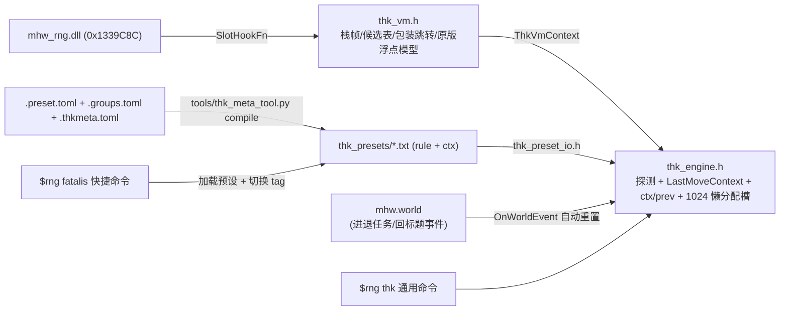

# `rng_thk` 官方插件技术文档（通用 THK 随机节点探测与纯 RNG 控招引擎）

- **插件标识**：`thk`（编译产物 `rng_thk.dll`，版本 `1.4.0`）
- **开发 / Agent 入口**：[`AGENTS.md`](AGENTS.md)
- **源码与工具目录**：
  - [`thk_vm.h`](thk_vm.h)：与具体怪物无关的 15.23 THK 虚拟机只读解析与浮点抽签反算/仿真
  - [`thk_engine.h`](thk_engine.h)：任意节点探测、单只怪物上下文（`LastMoveContext`）、计数门控（`CountGate`、`kMaxRuleCounters = 1024U` 懒分配）、命名上下文过滤（`ctx` / `prev_*` / `prev_ctx`）与有序出招序列引擎
  - [`thk_preset_io.h`](thk_preset_io.h)：声明式纯文本预设解析器（`thk_presets/*.txt`，支持 `ctx` 与 `rule` 指令）
  - [`thk_plugin.cpp`](thk_plugin.cpp)：插件入口、`mhw.world` 事件监听（进/退任务、回标题自动清零运行时计数）、双语命令（`$rng thk` / `$rng fatalis`）与 Tab 补全
  - [`tools/thk_meta_tool.py`](tools/thk_meta_tool.py)：离线 THK 静态提取、只读查询（`overview`/`moves`/`inspect`/`switches`/`followups`/`diff`/`query`/`coverage`）、TOML 1.0 编译器（`compile`）与等价性校验器（`verify`）
  - [`presets/`](presets) & [`presets/sources/em013/`](presets/sources/em013)：
    - [`presets/fatalis_p1_nasty.txt`](presets/fatalis_p1_nasty.txt)：黑龙一阶段二足与四足预设（内置兜底文本 [`presets/fatalis_p1_nasty.h`](presets/fatalis_p1_nasty.h)）
    - [`presets/fatalis_sweet.txt`](presets/fatalis_sweet.txt)：黑龙全阶段好打版预设（由 [`presets/sources/em013/fatalis_sweet.preset.toml`](presets/sources/em013/fatalis_sweet.preset.toml) 编译生成）
  - [`docs/TOML_LANGUAGE_MANUAL.md`](docs/TOML_LANGUAGE_MANUAL.md)：高层声明式 TOML 1.0 编排语言与静态工具完整手册
  - [`PRESET_GUIDE.md`](PRESET_GUIDE.md)：底层 `.txt` 预设语法手册与运行期排查清单
  - [`tests/`](tests)：[`run_thk_meta_tests.py`](tests/run_thk_meta_tests.py)（编译器/校验器回归）与 [`test_prev_move.cpp`](tests/test_prev_move.cpp)（C++ 状态机单测）
- **宿主依赖**：`mhw_rng.dll`（Plugin SDK `kMhwRngApiVersion == 3` v3.5，头文件 [`include/mhw_rng_api.h`](include/mhw_rng_api.h)；可选订阅 `mhw.world` 事件）
- **接管调用点**：`RVA 0x1339C8C`（`cThinkMgr::updateThk` @ `0x141339640` 内唯一的 `CALL MtRandom::nrand`）

---

## 一、分层设计与工作流



1. **只读纯 RNG 控制**：所有干预均通过 `RegisterSlotHook(0x1339C8C)` 返回 `kMhwRngActionReturnValue(u32)` 完成。开启探测（`$rng thk probe on`）或存在依赖 `lastMove` / `move:<F>:<N>` 的激活规则时，未受控决策会通过 `DrawDeterministic` 只读仿真原版选枝，不改变原有随机分布。
2. **全功能上一招上下文追踪（`LastMoveContext`）**：引擎在控招与原版掷骰命中具体招式时统一记录目标动作（`moveFile:moveNode`）与发起上下文（`depth`、`file`、`node`、`seg0`、`callerChain[]`）；中间经过纯控制流分支（`ENDR`/`RANDOM`/`ELSER`）不会覆盖上一招状态。支持内联 `prev_*` 与命名多槽 `ctx` / `prev_ctx` 联动，且完全无状态（消耗 `0` 个规则计数槽）。
3. **懒分配大容量规则计数器（`kMaxRuleCounters = 1024U`）**：单只怪物实例（最多 8 个活跃槽）仅在规则包含计数门控（`after`/`until`/`every` + `when=rule`）或状态步进序列时才按需分配计数器槽位；无状态规则消耗 `0` 槽位。订阅 `mhw.world` 任务进入/退出/回标题事件并在目标变化时自动清零。
4. **1-hop 包装节点与局部返回栈还原**：`thk_vm.h` 自动沿 `seg + 0x30` 解析真实 `(targetThkFile, targetNodeId)`，并在 `depth == 1` 时遍历 `mgr + 0x200`（计数 `mgr + 0x340`）还原完整 `callerChain[]`。

---

## 二、常用聊天命令（`$rng thk`）

### 1. 任意节点探测与出招计数
| 命令格式 | 说明 |
| :--- | :--- |
| `$rng thk` / `status` | 查看当前加载的预设、启用规则数、探测开关、最近怪物实例计数与世界上下文摘要 |
| `$rng thk probe on [怪ID]` | 开启实时节点探测（可指定 `MonsterID` 如 `91` 金狮子、`101` 黑龙；省略为全怪物） |
| `$rng thk probe off` / `probe log` | 关闭探测；或查看最近 10 条抽签详情（含 `[控]/[原]`、`d/f/node/seg0/caller`、候选与命中结果） |
| `$rng thk nodes [怪ID]` | 按访问次数降序列出命中过的 `(depth, file, node, seg0)` 节点 |
| `$rng thk stats [怪ID]` | 显示上一招摘要 `Last move / 上一招: f:n (from d=... f=... node=... seg0=...)`，以及总决策数和各招式受控/自然次数 |
| `$rng thk reset` | 清零所有怪物运行时节点、上一招上下文、出招计数与序列游标（保留当前规则与预设） |

### 2. 自定义计数规则与有序出招序列
| 命令格式 | 说明 |
| :--- | :--- |
| `$rng thk rule add <怪\|*> <node> <seg0\|*> <目标> [修饰符...]` | 添加计数条件 / 上下文联动控招规则 |
| `$rng thk seq <怪\|*> <node> <seg0\|*> <t1,t2,...> [loop\|hold\|once] [修饰符...]` | 添加有序出招序列（例如 `55:172,55:185,55:297`） |
| `$rng thk rule list` / `del <id>` / `clear` | 查看、删除或清空自定义规则 |
| `$rng thk clear` / `off` | 清空自定义规则、停用预设与探测，恢复原版随机 |

- **目标写法**：`file:node`（如 `55:297`）、主控/备选回退 `55:184|55:188`、按权重概率组合 `55:217(50)+55:277(50)`、控制标志 `ENDR` / `RANDOM` / `ELSER`、段下标 `seg:10`、候选下标 `cand:0`、或序列原版透传步 `vanilla`。
- **常用修饰符**（均支持 `$rng thk` 命令行 Tab 补全）：
  - `after=N` / `until=M` / `every=P:Ph` 与 `when=rule|node|total|move:<F>:<N>`：基于计数区间、周期或历史招式次数触发。
  - `prev=F:N,...`、`prev_d=`、`prev_f=`、`prev_node=`、`prev_seg0=`、`prev_caller=`：过滤上一具体招式及其发起上下文。
  - `scope=fired|node|total`、`loop|hold|once`、`label="..."`、`label_en="..."`、`d=0|1`、`f=0,4|55`、`caller=c1,c2`。

### 3. 声明式预设管理与 `$rng fatalis` 快捷入口
| 命令格式 | 说明 |
| :--- | :--- |
| `$rng thk preset list` | 列出 `nativePC\plugins\mhw_rng\thk_presets\*.txt` 与内置预设 |
| `$rng thk preset load <名称>` | 加载外部预设文件（例如 `fatalis_sweet` 或 `fatalis_p1_nasty`） |
| `$rng thk preset reload` | 热重读当前 `.txt` 预设文件（无需重新编译 DLL） |
| `$rng thk preset tag <标签> on\|off` / `off` | 按标签开关预设内的规则分组（如 `guard`、`far_multi`）或停用预设 |
| `$rng fatalis on\|off\|status\|history\|diag` | 加载/停用 `fatalis_p1_nasty` 预设并查看黑龙统计的快捷入口 |
| `$rng fatalis far single\|multi` / `guards on\|off` | 切换黑龙 `>4500` 火球模式（`far_single`/`far_multi`）与 P1 辅助守卫（`guard`） |

---

## 三、声明式 TOML 编排与底层预设语法

- **推荐工作流（高层 TOML 1.0 -> 静态编译为 `.txt`）**：使用 [`tools/thk_meta_tool.py`](tools/thk_meta_tool.py) 提取 `.thkmeta.toml` 事实索引并编写 `.groups.toml` + `.preset.toml`，支持按阶段、姿态、距离区间、角度扇区、多路径收敛条件、`ban`/`allow`/`fallback` 与 `prev = { move = ..., when = { ... } }` 上下文联动自动编译并折叠 `seg0`，详见 [**`docs/TOML_LANGUAGE_MANUAL.md`**](docs/TOML_LANGUAGE_MANUAL.md)。
- **底层 `.txt` 语法详情**：完整的 `ctx` / `rule` 语句规范、字段表、计数公式与运行期排查清单，请查阅 [**`PRESET_GUIDE.md`**](PRESET_GUIDE.md)。

---

## 四、独立构建与部署

```bat
sync_sdk.bat <path-to-mhw-rng>
build.bat --deploy
```

- `build.bat --deploy` 会编译 `build\rng_thk.dll`，并将 `rng_thk.dll` 与 `presets\*.txt` 一并复制到游戏 `nativePC\plugins\mhw_rng\`（同时自动清理旧版 `rng_fatalis.dll` 避免冲突）。
- 回归测试：
  - Python 全套（编译器、等价性校验与字节码回放）：`python tests/run_thk_meta_tests.py [--main-thk <em013_00.thk>]`
  - C++ 引擎状态机单测：编译运行 [`tests/test_prev_move.cpp`](tests/test_prev_move.cpp)
