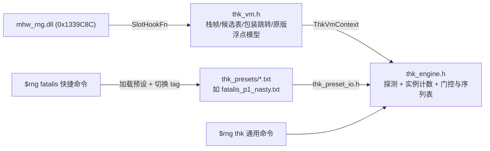

# `rng_thk` 官方插件技术文档（通用 THK 随机节点探测与纯 RNG 控招引擎）

- **插件标识**：`thk`（编译产物 `rng_thk.dll`，版本 `1.0.0`）
- **源码结构**：
  - [thk_vm.h](thk_vm.h)：与具体怪物无关的 15.23 THK 虚拟机只读解析与浮点抽签反算/仿真
  - [thk_engine.h](thk_engine.h)：任意节点探测、单只怪物计数、计数条件门控（`CountGate`）与有序出招序列引擎
  - [thk_preset_io.h](thk_preset_io.h)：声明式纯文本预设解析器（`thk_presets/*.txt`）
  - [thk_plugin.cpp](thk_plugin.cpp)：插件入口、`$rng thk` 通用指令与 `$rng fatalis` 预设快捷入口
  - [presets/fatalis_p1_nasty.txt](presets/fatalis_p1_nasty.txt)：黑龙一阶段二足预设（内置兜底文本 [presets/fatalis_p1_nasty.h](presets/fatalis_p1_nasty.h)）
  - [PRESET_GUIDE.md](PRESET_GUIDE.md)：`.txt` 声明式预设完整语法手册与新怪物编写实战指南
- **宿主依赖**：`mhw_rng.dll`（Plugin SDK `kMhwRngApiVersion == 2`，头文件 [mhw_rng_api.h](include/mhw_rng_api.h)）
- **接管调用点**：`RVA 0x1339C8C`（`cThinkMgr::updateThk` @ `0x141339640` 内唯一的 `CALL MtRandom::nrand`）

本文档说明 `rng_thk` 如何将底层 THK 随机节点探测、计数与序列控招能力与具体怪物预设完全解耦，全程不安装额外游戏 Hook、不修改 `.thk` 脚本、不写入游戏 AI 内存。

---

## 一、分层设计与解耦边界



1. **只读纯 RNG 控制**：所有干预均通过 `mhw_rng` 的 `RegisterSlotHook(0x1339C8C)` 返回 `kMhwRngActionReturnValue(u32)` 完成。开启探测（`$rng thk probe on`）且当前无控制规则命中时，回调通过 `ctx->DrawDeterministic(0x1339C8C, 0)` 获取原应产出的确定性随机数并仿真选枝，仅做只读观测与计数，不改变原本随机分布。
2. **与怪物实例绑定的计数与序列重置**：引擎以 `(Monster*, MonsterID)` 维护最多 8 个活跃怪物实例槽（`MonsterRuntimeTracker`）。每当切换或新刷出一只怪物（对象地址变化或同地址上的 `MonsterID` 变化）时，该实例的决策总数、节点访问次数、招式次数与序列游标自动从 0 开始计算。
3. **1-hop 包装节点与局部返回栈还原**：对注入了自定义探针的 `.thk`（例如先跳转 4 段局部中继节点再调目标招式），`thk_vm.h` 会自动沿 `seg + 0x30` 解析真实 `(targetThkFile, targetNodeId)`，并在 `depth == 1` 时遍历 `mgr + 0x200`（计数位于 `mgr + 0x340`）还原完整 `callerChain[]`，不依赖特定怪物节点数上限。

---

## 二、常用聊天命令（`$rng thk`）

### 1. 任意节点探测与出招计数
| 命令格式 | 说明 |
| :--- | :--- |
| `$rng thk` / `status` | 查看当前加载的预设、启用规则数、探测开关与最近怪物实例计数摘要 |
| `$rng thk probe on [怪ID]` | 开启实时节点探测（可指定 `MonsterID` 如 `91` 金狮子、`101` 黑龙；省略为全怪物） |
| `$rng thk probe off` / `probe log` | 关闭探测；或查看最近 10 条抽签详情（含 `[控]/[原]`、`d/f/node/seg0/caller`、候选与命中结果） |
| `$rng thk nodes [怪ID]` | 按访问次数降序列出命中过的 `(depth, file, node, seg0)` 节点 |
| `$rng thk stats [怪ID]` | 列出总决策数与各目标招式 `file:node` 的累计次数（区分控制次数与原版自然次数） |
| `$rng thk reset` | 清零所有怪物运行时计数与序列游标（保留当前规则与预设） |

### 2. 自定义计数规则与有序出招序列
| 命令格式 | 说明 |
| :--- | :--- |
| `$rng thk rule add <怪\|*> <node> <seg0\|*> <目标> [修饰符...]` | 添加计数条件控招规则 |
| `$rng thk seq <怪\|*> <node> <seg0\|*> <t1,t2,...> [loop\|hold\|once] [修饰符...]` | 添加有序出招序列（例如 `55:172,55:185,55:297`） |
| `$rng thk rule list` / `del <id>` / `clear` | 查看、删除或清空自定义规则 |
| `$rng thk clear` / `off` | 清空自定义规则、停用预设与探测，恢复原版随机 |

- **目标写法**：`file:node`（如 `55:297`）、主控/备选回退 `55:184|55:188`、控制标志 `ENDR` / `RANDOM` / `ELSER`、段下标 `seg:10`、候选下标 `cand:0`、或在序列中插入原版透传步 `vanilla`。
- **常用修饰符**：
  - `after=N` / `until=M` / `every=P:Ph`：基于计数区间或周期触发（例如 `after=2 until=3` 仅在第 2、3 次命中时接管）。
  - `when=rule|node|total|move:<F>:<N>`：计数作用域，支持按规则命中次数、节点访问次数、怪物总决策数、或指定招式 `<F>:<N>` 已发生次数进行门控。
  - `scope=fired|node|total` 与 `loop|hold|once`：控制序列表步进方式以及播完后的行为（循环 / 停在末项 / 恢复原版）。
  - `d=0|1`、`f=0|55`、`caller=c1,c2`：可选层数、THK 文件号与调用链过滤。

### 3. 声明式预设管理与 `$rng fatalis` 快捷入口
| 命令格式 | 说明 |
| :--- | :--- |
| `$rng thk preset list` | 列出 `nativePC\plugins\mhw_rng\thk_presets\*.txt` 与内置预设 |
| `$rng thk preset load <名称>` | 加载外部预设文件（例如 `fatalis_p1_nasty`） |
| `$rng thk preset reload` | 热重读当前 `.txt` 预设文件（无需重新编译 DLL） |
| `$rng thk preset tag <标签> on\|off` / `off` | 按标签开关预设内的规则分组（如 `guard`、`far_multi`）或停用预设 |
| `$rng fatalis on\|off\|status\|history\|diag` | 加载/停用 `fatalis_p1_nasty` 预设并查看黑龙统计的快捷入口 |
| `$rng fatalis far single\|multi` / `guards on\|off` | 切换黑龙 `>4500` 火球模式（`far_single`/`far_multi`）与 P1 辅助守卫（`guard`） |

---

## 三、预设文件语法（`thk_presets/*.txt`）

预设文件为纯 UTF-8 文本，以 `#` 开头为注释。完整语法字段（过滤、`seg0` 区间、备选回退、计数门控、序列模式与 4 步新怪物探测编写流程）请直接查阅专门指南：[**PRESET_GUIDE.md**](PRESET_GUIDE.md)。

```ini
name = example_preset
desc = 自定义示例预设
disable_tag = opt

# 对 MonsterID=91 第 2~3 次进入 node=12 (seg0=1) 时依次强制出 55:172 与 55:185
rule mon=91 d=0 f=0 node=12 seg0=1 -> 55:172,55:185 end=once label="示例两连序列"
```

---

## 四、独立仓库目录与构建部署

- `thk_vm.h` / `thk_engine.h` / `thk_preset_io.h` / `thk_plugin.cpp`：通用 THK 引擎源码
- `presets/fatalis_p1_nasty.txt` 与 `presets/fatalis_p1_nasty.h`：黑龙 P1 二足声明式预设与内置文本兜底
- `include/mhw_rng_api.h`：Plugin SDK v2 头文件本地副本（通过 `sync_sdk.bat` 同步）
- `build.bat`：编译 `build\rng_thk.dll`（`--deploy` 会同时部署 `rng_thk.dll`、`thk_presets\fatalis_p1_nasty.txt`，并清理旧版 `rng_fatalis.dll` 以避免同挂 `0x1339C8C` 冲突）

```bat
sync_sdk.bat D:\path\to\mhw-rng
build.bat --deploy
```
