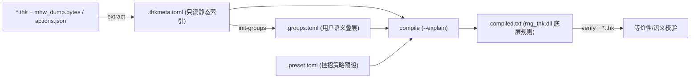

# MIRA THK 声明式 TOML 语言手册（v3.3+）

本文档是 **MIRA（`rng_thk.dll`）** 静态 THK 规则编排语言的完整参考手册，对应实现 [`tools/thk_meta_tool.py`](../tools/thk_meta_tool.py)（v3.3+），全部文件严格采用标准 **TOML 1.0**（Python 标准库 `tomllib` 解析，推荐使用 `[[rules]]` 与 `[rules.when]` / `[rules.do]` 写多行规则）。

---

## 一、核心理念与三层文件架构

### 1.1 静态预编译模型（Zero Runtime Guess）
- `.preset.toml` 中写的 `dist`、`angle`、`phase`、`stance`、`charged` 等条件，**全部源自 `.thk` 字节码静态分支传播出来的精确条件集合**。
- 编译器在离线阶段把高层语义规则精准解析并折叠为 `rng_thk.dll` 原生底层规则（`rule mon=... d=... f=... node=... seg0=... -> ...`）。
- 因此：
  1. **运行期无任何实时距离/角度观测误差**：不存在 `898 vs 900` 边界抖动，因为选中的就是游戏原本在 `900` 阈值分支上的固定 `node` + `seg0`。
  2. **独立编译无运行期重度依赖**：一旦提取好 `.thkmeta.toml`，后续 `init-groups`、`query`、`compile` **只读 `.toml` 文件**，完全不需要原 `.thk` 或 PE 内存转储文件。

### 1.2 三层架构与数据流



| 文件层 | 职责 | 谁来维护 | 重新提取 `.thkmeta.toml` 是否覆盖 |
| :--- | :--- | :--- | :--- |
| **`<em_id>.thkmeta.toml`** | 自动提取的只读事实索引：招式映射、子节点画像、`d=0/d=1` 可达随机点与真实条件 | CLI `extract` 全自动生成（**勿手动改**） | 是（版本升级或解包更新时重建） |
| **`<em_id>.groups.toml`** | 针对单只怪的语义词典：`[conditions]` 别名、`[groups.*]` 状态/距离/角度/上下文分组、`[moves]` 别名、`[move_groups]` 合并组 | `init-groups` 生成骨架后由作者按需完善，多套预设可复用同一份 | **否**（独立保存，不受重建影响） |
| **`<preset>.preset.toml`** | 面向玩家的纯粹控招策略：规则列表、权重分配、派生控制、连招序列、门控、标签与双语展示文本 | 作者编写 | **否** |

---

## 二、第一层：只读静态索引（`.thkmeta.toml`，`meta_version = 3`）

通过 `thk_meta_tool.py extract` 从主 THK 及兄弟子 THK 自动提取，包含以下固定分节：

1. **`[header]`**：
   - `meta_version = 3`、`mon`（数字 `MonsterID`）、`em_id`（如 `"em013"`）、`default_files`（默认 `d=0` 文件槽位列表，默认为 `[main_idx]`，可通过 `--default-files` 覆盖）、`sub_files`（仅包含主 THK 实际 `sg.tf` 引用到的子文件槽位）、`sources`（参与提取的 `.thk` 文件名列表）、可选 `enum_ops`（由 `--enum-ops` 传入并导出，例如 `["em_101", "em_103"]`，供编译期互斥枚举判定使用）。
2. **`[moves]`**：
   - 形式为 `snake_case_name = ["<file>:<nid>", ...]`（`Move -> [list of nodes]`）。
   - 若同一个 `snake_case` 主动作名在**同一 `d=0` `RANDOM` 块内出现 ≥ 2 个不同子节点**（同块共现），`disambiguate_cooccurring_group()` 按通用 5 级结构差分自动加后缀拆分：
     1. 后续派生链 `chains`（如 `l2_vertical_escape_dust_explosion_start` vs `l2_vertical_escape_dust_explosion_start_chain`）
     2. 直接战斗动作签名 `direct_combat`
     3. 全量内部条件检查 `internal_checks` 的对称差集（如 `glide_combat_dist1000` vs `glide_combat_dist4000`）
     4. 状态寄存器写入 `var_writes`（`0x80..0x93`）
     5. 动作终止参数 `end_params`（段偏移 `+0x50..+0x6C`）
   - 若所有属性完全同构，则保持合并并交由编译期 `AmbiguousMoveError` 防错拦截。
3. **`[subnodes]`**：
   - 键值 `"<file>:<nid>" = { idx = ..., move = "...", has_rand = true, checks = [...], chains = [...], var_writes = [...], end_params = [...] }`。
   - `checks` 基于 `FL_IF`/`FL_ELIF_ELSE`/`FL_ENDIF` 极性栈提取（正确反映 `ELSE` 否定极性，例如 `dist>=800` 而非 `dist<800`）；当某子节点无直接战斗动作时，自动向非移动子 `lj` 节点最多递归 2 层补齐内部检查。
4. **`[inline_actions]`**（存在内联动作时生成）：
   - 记录主/子 THK `RANDOM` 块中 `tf < 0` 且直接执行 `act > 0` 的映射，例如 `37 = "l2_rush_start"`，使预设可直接按招式名选中内联动作并编译为 `seg:<idx>`。
5. **`[node_segs.d0]` 与 `[node_segs.d1]`**：
   - 每个含 `RANDOM` 块的节点下所有 `seg0` 编号列表，用于编译期将离散命中的段自动折叠成 `*`、`N`、`A..B` 或 `N+`。
6. **`[points.d0.n<idx>]` 与 `[points.d1.n<idx> / f<tf>_n<idx>]`**：
   - `d=0` 点含 `parents`、`via`、`dist` / `dist3d` / `angle` / `preds`（或多路径时的 `paths = [ {...}, {...} ]`）、`cands`，以及可选的多段候选体副作用字段 **`effects`**。
   - `d=1` 点含 `callers`（可达主 THK 入口节点列表）、可选 `entry_owners`（子 THK 入口子节点）、继承+局部条件状态、`cands` 与可选 `effects`。
   - 对内联 `act:*` 与 `d=1` 本地跳转 `lj:*` 候选，`cands` 键名强制保留 `@seg<N>` 后缀（如 `"lj:85|ELSER@seg4" = 30`、`act:37|ELSER@seg10 = 35`），确保可精确反查段号。
   - **`effects = { ... }`（多段候选体副作用，v3.2 新增）**：当某 `RANDOM` / `ELSER` / `ENDR` 候选体在头段之后、下一个同级分支或 `FL_END_RANDOM` 之前还包含额外字节码段时，静态索引自动采集其真正执行的目标调用/跳转（如 `"l2_rush_start(55:215)"`、`"fly_switch_l2_assault_start(act:115)"`、`"l2_special_wide_range_fire_shoot(lj:73)"`）与状态寄存器写入（如 `"write:var_5=1"`、`"write:var_0=0"`）并附带行尾可读注释。例如黑龙 `d0.n14.s22` 的 `effects` 同时给出 `RANDOM = ['l2_switch_l4_body_press(55:174)', 'l2_switch_l4(55:232)', 'write:var_0=1', 'write:var_11=1']` 与 `ENDR = ['write:var_0=0']`，作者编写 `do = "cancel"`（`-> ENDR`）或 `do = "trigger"`（`-> RANDOM`）前可直接从 `.thkmeta.toml` 看清该分支到底会执行什么或清零什么寄存器。

### 已内置可读解码的 `Global::AI_Interpreter` 通用谓词

| 谓词格式 | 含义与来源操作码 |
| :--- | :--- |
| `dist<val>` / `dist>=val` / `dist=[lo, hi]` | 水平距离（`0x08`/`0x09`） |
| `dist3d<val>` / `dist3d>=val` | 3D 空间距离（`0x06`/`0x07`） |
| `home_dist<=val` / `>`、`target_home_dist<=val` / `>` | 怪物/目标距归巢点距离（`0x0a..0x0d`） |
| `abs_dy<=val` / `>`、`dy<0` / `dy>=0` | 高度差与上下方位（`0x0e..0x10`） |
| `angle=A..B`（或 `!` / 多扇区 `\|`） | 目标水平方位角扇区（`0x14..0x17`，自动处理补集） |
| `target_angle=...`、`pitch_angle=...` | 目标朝向角 / 俯仰角（`0x18..0x1b`） |
| `in_combat`、`enraged`、`fatigued` | 战斗 / 愤怒 / 疲劳状态（`0x1c`/`0x1e`/`0x1f`） |
| `status_poison`、`status_19`、`status_17`、`status_active=P` | 异常状态判定（`0x20..0x22`/`0xb2`） |
| `hp_pct<=val` / `>`（或 `hp_pct(p1,p2)`） | 体力百分比（`0x2c`） |
| `target_type=P`、`target_state=P`、`target_dead` | 目标类型 / 状态（如 `5` 倒地/受控）/ 死亡（`0x2d..0x2f`） |
| `quest_id<cmp>P` | 任务 ID 比较（`0x37`） |
| `flying`、`part_damaged(p1,p2)`、`recent_act(p1,p2)`、`part_clutched=P` | 滞空 / 部位受损 / 近期动作 / 钩爪部位（`0x70`/`0x75`/`0x76`/`0x7f`） |
| `var_0..var_19<cmp>P` | THK 局部变量寄存器比较（`0x94..0xa7`；`0x80..0x93` 写入记入 `[subnodes].var_writes`） |
| `parent_sub_id=P`、`clutch_mount_<hex>...`、`current_action_flag` | 父子编号 / 钩爪骑乘（`0xd2..0xfd`）/ 当前动作标记（`0x100`） |
| `em_<hex>` / `op_<hex>` | 怪物私有条件（`0x101..0x120`）及其他全局未命名操作码的无损十六进制表示 |

---

## 三、第二层：用户语义叠层（`.groups.toml`）

可用 `init-groups --meta <em_id>.thkmeta.toml -o <em_id>.groups.toml` 先铺开全量骨架，再按如下 4 个核心分节自由定义。

### 3.1 `[conditions]`（底层谓词重命名）
把枯燥或未知的 `em_*` / `var_*` / `op_*` 映射为人类可读别名：
```toml
[conditions]
posture   = "em_101"
stage     = "em_103"
charge_cd = "var_5"
```
支持两种使用方式：
- 原样引用布尔谓词：`occluded`（展开为 `em_10d`）
- 后接比较符展开：`charge_cd>=7`（展开为 `var_5>=7`）

### 3.2 `[groups.<维度>]`（状态、范围、扇区与上下文分组）
支持任意自定义二级命名空间（如 `[groups.phase]`、`[groups.stance]`、`[groups.range]`、`[groups.dir]`、`[groups.context]`）及组合简写（如 `[groups.p1]`）：
```toml
[groups.phase]
p1 = "em_103=0"
p2 = "em_103=1"
p3 = "em_103!=0 & em_103!=1"

[groups.stance]
bi   = "em_101=0"
quad = "em_101=1 | (flying=false & em_101!=0)"
fly  = "flying"

[groups.p1]
bi = "phase=p1 & stance=bi"   # 支持嵌套引用其他组（最大展开深度 16）

[groups.range]
bi_close = "dist <= 900"
bi_mid   = "dist in 900..2000"

[groups.dir]
front = "angle in -45..45"
side  = "angle in 45..135 | -135..-45"
```

#### 布尔表达式完整语法与三态静态语义
- **逻辑运算符 vs 静态证明否定（v3.3 关键区分）**：
  - **前缀 `!`（二值选择器取反）**：语义是“该表达式在当前点未满足”（例如 `!node=18`、`!em_106=1`、`!has=l4_tail_slam`）。若某点根本没判断过 `em_103`，`!em_103=0` 仍会因未命中 `em_103=0` 而返回 `True`。
  - **中缀 `!=` 与 `=false` / `=true`（三态静态证明否定，v3.3 新增）**：
    - `k!=v` 要求 `preds` 中**静态证明了否定分支**（`extract` 提取的 `k!=v`、兼容旧 meta 的 `!k=v`、数值区间蕴含、或 `[header].enum_ops` 声明的互斥枚举值如 `em_103=1` 自动蕴含 `em_103!=0`）。对于从未分支判断过 `k` 的通用节点，返回 `False`，彻底杜绝 `p3` / `quad` 误吸。
    - `flag=false` / `flag=true` 用于布尔谓词的显式静态证明：分别检查 `"!flag" in preds` 与 `"flag" in preds`（例如 `flying=false` 仅命中显式位于 `!flying` 分支下的点）。
  - 优先级：`!`（取反） > `&`（逻辑与） > `|`（逻辑或），支持任意层括号 `(...)`；比较符与关键词前后允许正常空格（如 `dist <= 900`、`angle in -45..45`、`var_11 >= 1`）。
- **距离静态包含（`dist` 与 `dist3d`）**：
  - 写法：`dist in A..B` / `dist <= X` / `dist < X` / `dist >= X` / `dist > X` / `dist = X`（亦兼容旧紧凑写法 `dist=900..2000`、`dist<=900`、`dist3d` 同理）。
  - **严格子区间包含语义**：节点的实际可达距离区间 `[p_lo, p_hi)` 必须**完全落入**要求区间 `[s_lo, s_hi]` 内（`p_lo >= s_lo and p_hi <= s_hi`）才判定为 `True`。例如 `[1000, 2000)` 满足 `dist in 900..2000`，而未限定距离（`[0, inf)`）的点对 `dist3d <= 600` 返回 `False`。
  - 若写入非法 `dist*` 写法（如 `distfoo`），会立即抛出 `ValueError` 而不会静默放行。
- **角度环形包含（`angle in ...`）**：
  - 推荐写法：`angle in -45..45`、`angle in 45..135 | -135..-45`（支持负数角度按 `mod 360` 自动回卷，例如 `-45..45` 等价于 `315..45`；`-135..-45` 等价于 `225..315`）。同时向后兼容 `angle=315..45` 与旧版 `angle<=315..45`。
  - 支持跨 `0°` 扇区和多扇区并集；采用 **360° 圆周子集包含**：点位角度集合 `st.angles` 必须完全是目标扇区的子集（`st.angles ∩ complement(req) == ∅`）。
- **数值区间蕴含**：
  - 对 `var_*`、`quest_id`、`hp_pct`、`abs_dy`、`home_dist`、`target_home_dist`、`op_<hex>`，支持 `=`、`!=`、`>`、`>=`、`<=`、`<` 及 `in A..B`（兼容 `=A..B`），例如 `var_0 in 7..14`、`var_11 < 1`。
  - 依据 `preds` 中已收集的全部约束做保守区间蕴含判定（例如节点含 `hp_pct<=77` 时 `hp_pct<=80` 为 `True`；节点含 `var_0=6` 时 `var_0>5` 与 `var_0<=10` 均为 `True`）。
- **拓扑与候选原子**：
  - `parent=11` / `parent=11,12`：主 THK 直接父节点下标之一在集合内。
  - `via=127`：到达本点的调用路径 `vias` 中包含该节点下标。
  - `node=18` / `node=18,19,21`：当前节点数组下标匹配。
  - `in=<move>`：当前 `d=1` 点自身所属节点（`owner_tf:owner_tn` 或 `[subnodes].move`）属于 `<move>`。
  - `has=<move>`：当前点的**正权重候选列表 `cands` 中存在 `<move>`**（同时覆盖跨文件目标 `tf:tn`、主/子 THK 内联 `act:*` 与 `d=1` 本地跳转 `lj:*`）。

### 3.3 `[moves]` 与 `[move_groups]`（招式别名与联合组）
- **`[moves]`**：`init-groups` 会在本节铺开全部自动转换好的 `snake_case` 招式名（**零节点 ID**）。
  - 左值不变即保留原名（`l2_under_breath = "l2_under_breath"`）；
  - 可把左侧改名为顺手的短别名（如 `cone = "l2_under_breath"`），或直接映射为数组。
- **`[move_groups]`**：用于把**两个及以上不同招式**合并成同一个名称或回退池（同样零节点 ID）：
  ```toml
  [move_groups]
  carpet = ["l2_vertical_escape_dust_explosion_start", "l2_far_dust_explosion_start"]
  ```
- **消歧后缀**（仅同一块内同名招式结构完全一致、触发 `AmbiguousMoveError` 时使用）：
  - `move@55:297`（按 `<file>:<nid>` 过滤）或 `move#297`（按 `<nid>` 过滤），也可直接写 `<file>:<nid>` 或 `seg:<N>`。

---

## 四、第三层：声明式控招预设（`.preset.toml`）

### 4.1 顶层头字段

| 字段 | 必填 | 类型 | 说明 |
| :--- | :---: | :--- | :--- |
| `meta` | 建议 | string | 配对的 `.thkmeta.toml` 相对路径或前缀（也可用 `--meta` 指定） |
| `groups` | 可选 | string | 配对的 `.groups.toml` 相对路径或前缀（也可用 `--groups` 指定） |
| `name` | 建议 | string | 导出到 `.txt` 顶部的预设名 |
| `desc` / `desc_en` | 可选 | string | 中/英文预设描述 |
| `disable_tag` | 可选 | string \| list | 默认禁用的标签，如 `["far_multi", "bipedal_lock"]` |
| `files` | 可选 | int \| list | 显式覆盖编译输出中所有 `d=0` 规则的 `f=` 列表（省略时沿用 `meta` 的 `default_files`） |
| `[group_ids]` | 可选 | table | 默认完全省略；仅需为 `$rng status` 遥测固定特定整数 `cond=<id>` 分组号时定义（兼容旧键名 `[stats]`） |

### 4.2 `[[rules]]` 标准 TOML 1.0 规则写法（v3.3 推荐）

> [!TIP]
> 标准 TOML 1.0 不允许跨行 `{ ... }` 内联表。v3.3 统一推荐 **`[[rules]]`** 表数组格式：短规则单行写 `when = { ... }`，多条件或权重较多时拆成 **`[rules.when]` / `[rules.do]`** 子表，可自由换行和加行尾注释，100% 兼容 `tomllib`（旧版 `rules = [ { ... } ]` 仍完全兼容）。

```toml
[[rules]]
label = "P3 二足远程"
[rules.when]
p3 = "bi"
dist = ">= 900"
has = "l2_vertical_escape_dust_explosion_start_chain"
[rules.do]
l2_special_wide_range_fire_shoot = 40
l2_vertical_escape_dust_explosion_start_chain = 25
l2_high_power_three_breath_multi_start = 35
```

#### A. 选择器侧
1. **标准 `d=0` / 通用规则**：写 `when = { ... }` 或 `[rules.when]`（也兼容空格分隔字符串）：
   - 表内键值展开规则（各键值对之间默认为逻辑**与**）：

| `when` 表内写法 | 编译期展开的选择器 |
| :--- | :--- |
| `p1 = "bi"` | `p1=bi`（查找 `groups.p1.bi`） |
| `p1 = ["bi", "quad"]` | `(p1=bi\|p1=quad)`（列表内每一项均支持 `= 0` / `== 0` / `<= 500` 等比较符，或组合） |
| `stage = "!= 0"` / `"== 0"` / `var_0 = ">= 7"` | `stage!=0` / `stage=0` / `var_0>=7`（值以 `==` / `=` / 比较符开头时自动规整，支持 `conditions` 别名） |
| `flying = false` / `true` | `flying=false` / `flying=true`（三态静态证明 `!flying` / `flying`） |
| `dist = "< 900"` / `"in 900..2000"` | `dist<900` / `dist=900..2000`（`dist3d` 同理；也兼容 `"<900"` / `"900..2000"`） |
| `angle = "in -45..45"` / `"in 45..135 \| -135..-45"` | `ANGLE:-45..45` / `ANGLE:45..135;-135..-45`（也兼容 `"315..45"`） |
| `node = 62` / `[18, 19, 21]` | `node=62` / `node=18,19,21`（`via`、`parent` 同理） |
| `not_has = "l4_tail_slam"` | `!has=l4_tail_slam`（保留显式结构排除，字符串或列表） |
| `not_in = "move_a"` | `!in=move_a`（字符串或列表） |
| `expr = "em_103=0 & !flying"` | 原样注入任意复杂布尔表达式令牌 |

2. **派生规则语法糖 `followup`（专门针对 `d=1` 子 THK 调用）**：
   ```toml
   [[rules]]
   followup = "l2_under_breath"
   from = { p1 = "bi", context = "main" }
   do = "cancel"
   ```
   - `followup = "M"`：选中 `d=1` 且自身节点 `owner`（即 `pt.owner_tf:pt.owner_tn` 或其所属子 `move` 名）属于 `M` 的点，等价于 `d=1 in=M`。
   - **`from = { ... }`** / **`when = { ... }`**：`from` 固定筛选主 THK 调用者，`when` 始终筛选当前 `d=1` 节点自身。
   - *弃用兼容*：旧版 `sub_when` 仍可识别但会在 `stderr` 发出弃用警告，请改写为 `from` + `when`。
   - **重要区分**：`in=` / `followup=` 匹配的是该 `d=1` 块自身的 `owner` 节点，而不是 `entry_owners`。
3. **底层逃生口（仅特殊情况使用）**：可在 rule 中直接写 `d = 0/1`、`in = "..."`。

#### B. 目标动作侧：`do` vs `seq` vs `ban` vs `allow`（四选一互斥）

v3.3 在 `do` / `seq` 基础上新增 **`ban`** 与 **`allow`** 子集过滤动词，基于随机点**原版正权重候选表**直接删除/保留子集，其余候选自动按原版权重等比留存（无需手写重量字典）：

1. **单步/单决策动作 `do`（别名 `target`）**：

| 写法 | 编译效果 |
| :--- | :--- |
| `do = "l2_under_breath"` | 自动按命中点上下文与候选表锁定唯一目标；跨文件输出 `55:297`，内联 `act:*` / `d=1 lj:*` 输出 `seg:<s_idx>` |
| `do = "cancel"`（别名 `stop`/`no_branch`/`deny`） | 展开为控制字 `ENDR`（取消该可选分支，**先查 `.thkmeta.toml` `effects`**） |
| `do = "trigger"`（别名 `take`/`proceed`） | 展开为控制字 `RANDOM`（100% 强制走该可选随机分支） |
| `do = "elser"` / `"vanilla"`（别名 `pass`/`skip`/`-`） | 分别展开为 `ELSER` 或原版透传步 |
| `do = { move_a = 50, move_b = 50 }` | 按权重组合展开为 `targetA(50)+targetB(50)` |
| `do = "move_a\|move_b"` | 在单点内部按候选存在性优先选 `move_a`，不可行则回退 `move_b` |

> [!IMPORTANT]
> `do` 不接受列表 `[...]` 或逗号分隔序列；`do` / `seq` / `ban` / `allow` 四者互斥，单条规则只能写其中之一。

2. **多决策序列 `seq = [...]`**：
   - 例如 `seq = ["l2_under_breath", "vanilla", { move_b = 70, move_c = 30 }]`（最多 16 步，每步最多 `kMaxStepChoices = 8` 个加权选项）。

3. **黑名单剔除 `ban`（v3.3 新增）**：
   - `ban = "rush"` / `ban = ["rush", "l2_switch_l4_body_press"]`：接受单个招式/`[move_groups]`/控制字或列表。
   - **逐点语义**：
     - 某点原版候选中**不包含**任何被禁项 -> 对该点不输出规则（保持原版）；
     - 剔除后仅剩 **1** 个候选 -> 自动折叠为单目标（如 `-> 55:277`）；
     - 剔除后剩 **2..8** 个候选 -> 保留每个幸存候选的原版权重（如 `-> 55:189(40)+55:277(25)`），由 `rng_thk.dll` 自动按权重归一化抽签；
     - **全删光（独苗强制点）**：跳过该点（留给原版），默认打印 `[WARNING]`；若是有意跳过必出独苗（如 `em_110=2`），可设 **`skip_if_all_banned = true`** 静默保留原版；
     - **剩余 > `kMaxStepChoices`（`8` 个，引擎上限）**：默认 **`on_overflow = "trim"`** 按权重从高到低保留前 8 个并向 `stderr` 打印 `[WARNING]` 说明保留权重占比与被裁候选；设 **`on_overflow = "error"`** 则直接编译报错。

4. **白名单过滤 `allow`（v3.3 新增）**：
   - `allow = ["l4_breath_multi_start_01", "l4_front_swing_breath"]`：只保留同时存在于白名单与原版正权重候选里的交集。
   - 若交集为空则在该点跳过；交集为 1 则折叠为单目标；交集为 2..8 则保留原版权重；若 `> 8` 则直接抛 `ValueError`（白名单超出引擎单步上限属于配置问题）。

#### C. 显式优先级兜底、标签、分组、序列与门控字段

| 字段 | 类型 / 值 | 对应底层行为 |
| :--- | :--- | :--- |
| **`fallback`** | bool（默认 `false`） | **v3.3 新增显式优先级级联**：设为 `true` 时，编译期与 `coverage` 自动减去**所有前置无门控（`prev.tags <= cur.tags`）规则已覆盖的 `(d=0 node,seg0)` 或 `d=1 caller`**，仅对剩余未覆盖点位生成规则且**不发遮蔽警告**。注意：`until`/`after`/`every`/`when_gate` 门控规则或带更窄 `tag` 的规则**不会**减去后续无门控/无标签 `fallback` 规则；若被前序规则完全覆盖导致剩 0 点（但原选择本身匹配 `>0` 点），打印 `[WARNING] ... 0 remaining uncovered points` 且不输出规则；可继续与 `not_has` 自由混用。 |
| `skip_if_all_banned` | bool（默认 `false`） | 仅配合 `ban` 使用：遇到“被 ban 后剩 0 个候选”的独苗点时静默跳过并保留原版，不打印警告 |
| `on_overflow` | `"trim"` \| `"error"` | 仅允许配合 `ban` 使用（用于非 `ban` 规则直接报错）：剔除后剩余候选 `> 8` 个时是裁剪最低权重并告警（默认 `"trim"`）还是编译报错（`"error"`） |
| `tag` / `tags` | string \| list | 标签名（自动转小写，列表用逗号拼接；任意 tag 被禁用时跳过规则） |
| `group` / `cond` | string / int | **可选（默认可省略）**；仅需配合 `$rng status` 遥测统计时使用：`cond` 直接指定整数 ID；`group` 先查顶层 `[group_ids]` 表，未列出则自 `2100` 起自动分配（兼容旧字段 `stat`） |
| `label` / `label_en` | string | 中/英文规则标签（用于 `--explain` 与运行期遥测显示） |
| `after` / `until` / `every` / `when_gate` | int / string | 透传为 `after=` / `until=` / `every=` / `when=` 计数门控 |
| **`prev_move`** / **`prev_when`** | string \| list / table \| string | 旧式兼容写法：分别过滤上一招命中目标 `move` 与发起时所在点位上下文 `prev_when`（不可与 `prev` 混用；`prev_when` 可单独使用） |
| **`prev`** | string \| list \| table | **全功能上一招 + 上下文过滤**：`prev = "move"` 为简写；表写法 `prev = { move = "...", when = { ... }, d = 0\|1, in = "...", from = { ... } }` 支持同时或单独按招式与发起上下文（阶段/姿态/距离/角度/节点/调用者等）匹配，并支持将条件键直接平铺于 `prev` 表中。单点折叠为规则行内联 `prev_d/prev_f/prev_node/prev_seg0/prev_caller`；多点自动去重为独立 `ctx <name>` + `prev_ctx=<name>`，同样不占用 `ruleCounters` 槽位、不屏蔽后续无门控规则。仅匹配上次真实选择具体动作的决策（原版或控招均计，`ENDR`/`RANDOM`/`ELSER` 控制流不覆盖），且编译器会在“前置无门控规则完全禁用了目标招式导致无法触发”时发 `[WARNING]` |
| `end` / `scope` | string | 透传序列选项：`end = "loop" \| "hold" \| "once"`，`scope = "fired" \| "node" \| "total"` |

```toml
# 1. 上招为某动作且满足上下文条件（多点自动折叠为 ctx + prev_ctx）
[[rules]]
when = { stance = "bi", dist = ">= 900" }
prev = { move = "l2_tail_swing", when = { stance = "bi", dist = "in 900..2000" } }
allow = ["l2_breath_single", "l2_high_power_three_breath_multi_start"]
label = "远程二足甩尾后 必单火球或三火球"

# 2. 仅过滤上招发起上下文（不限具体招式），或单点自动内联 prev_d/prev_f/prev_node/prev_seg0
[[rules]]
when = { p1 = "bi", dist = ">= 900", has = "l2_breath_single" }
prev = { when = { p1 = "quad" } }
do = "l2_breath_single"
label = "四足切二足后首招远程 单火球"
```

---

## 五、编译语义与安全护栏

1. **条件 + `Move -> [nodes]` 自动收窄与 `AmbiguousMoveError`**：
   - 对于 `do`/`seq` 中的单一招式引用，编译器检查当前点正权重候选中命中数：`0` 跳过、`1` 自动锁定唯一目标、`>=2` 立即抛出 `AmbiguousMoveError`；对于 `ban`/`allow`，会批量匹配目标招式/`[move_groups]` 下的全部候选。
2. **多路径汇合点全称保守语义（`all`）**：
   - 当同一个 `(node, seg0)` 可通过多条前置条件路径到达（`.thkmeta.toml` 中记为 `paths = [...]`）时，引擎要求**所有路径全部满足**规则选择器才会命中该点，避免跨阶段/跨条件串台。
3. **首匹配遮蔽检查 vs `fallback = true` 显式级联**：
   - 未标记 `fallback = true` 的规则仍受严格首匹配遮蔽检查保护（同点被无门控且 `prev.tags <= cur.tags` 的前序规则覆盖时在 `stderr` 报 `[WARNING]`），防止误覆盖；显式写了 `fallback = true` 的规则则明确表达“按从上到下优先级兜底未处理点”，不报遮蔽告警。
4. **`ban` / `allow` 死项与分支空转诊断（`compile` + `coverage`）**：
   - `compile` 若发现 `ban`/`allow` 中某个单项 `spec` 在该规则全范围内命中 `0` 候选、多值枚举分支（如 `phase = ["p1", "p2"]`）中某支实际改写 `<20%` 剩余点位、或整条 `ban` 规则在剩余点位中生效不足 `<25%`，均向 `stderr` 输出 `[WARNING]`，`--explain` 同时打印 `acted=X/Y,noop=Z`。
   - `coverage` 新增通用分组覆盖矩阵 `Group coverage (d=0)` 与 `ban-noop` 归因（JSON 字段 `group_breakdown`、`unused_action_specs`、`ban_noop_uncovered_count`、`uncovered[].ban_noop_by`），避免总覆盖率掩盖局部阶段/姿态空转。
5. **底层上限与输入合法性严格校验 + `seg0` 折叠**：
   - `parse_preset_rule()` 强制校验 `[[rules]]` 键白名单（`ALLOWED_RULE_KEYS`）防止拼写静默失效，且限制 `skip_if_all_banned` / `on_overflow` 仅能配合 `ban` 使用；
   - `do_spec_to_rhs_str()`、`resolve_action_at_point()` 与 `parse_low_preset()` 同步强制校验：加权项必须为有限正数（`> 0` 且非 `NaN`/`Inf`/布尔值），单规则步数 `<= MAX_RULE_STEPS (16)`，单步候选数 `<= MAX_STEP_CHOICES (8)`，`node=`/`caller=` 超过 `MAX_FILTER_ITEMS (8)` 自动拆行；
   - `rng_thk.dll` 已将每怪有状态规则计数器容量从 `64` 扩至 `kMaxRuleCounters = 1024U`，且通过 `RuleNeedsCounter()` 懒分配（无状态单步规则消耗 `0` 槽位）；当编译出的有状态底层规则超过 `1024` 条时，`compile` 会向 `stderr` 输出提示告警；
   - 同节点互斥单目标通过 `coalesce_fallback_per_node()` 自动合并为 `A|B`，连续 `seg0` 自动折叠为 `*` / `N` / `A..B` / `N+`。

---

## 六、CLI 命令速查、新怪物流程与 Agent 零膨胀查询流

### 6.1 `thk_meta_tool.py` 14 个子命令（7 个构建/编译/校验 + 7 个 Agent 只读查询）

| 子命令 | 关键参数 | 说明 |
| :--- | :--- | :--- |
| **`list-tables`** | `--dump <pe>` | 扫描解包 PE `.rdata`/`.data` 内全部 `32B ActionTable` 并输出 VA 与前缀 |
| **`export-actions`** | `--dump <pe> --em-id <id> [--va <addr>] -o <json>` | 导出某只怪的 `ActionID -> MtDTI` JSON；命中多张候选表时向 `stderr` 告警并提示用 `--va` 钉死 |
| **`extract`** | `--main <*_00.thk> [--actions <json> \| --dump <pe> \| --no-actions] [--va <addr>] [--sub <idx=path>] [--default-files 0,4] [--enum-ops 0x101,0x103] -o <out.thkmeta.toml>` | 提取只读 `.thkmeta.toml`；省略 `--sub` 时**仅自动加载主 THK 实际 `sg.tf` 引用到的子文件** |
| **`init-groups`** | `--meta <meta.toml> -o <groups.toml>` | 从 `.thkmeta.toml` 铺开带全部 `em_*`/`var_*`、距离区间提示与全量 `[moves]` 的可编辑 `.groups.toml` 骨架 |
| **`compile`** | `<preset.toml> [--meta ...] [--groups ...] [--explain] -o <out.txt>` | 离线独立编译为 `rng_thk.dll` 预设；`--explain` 输出每条规则命中的点位数量与招式池收窄轨迹 |
| **`query`** | `--meta <m> [--groups <g>] [--d 0\|1] [--when "..."] [--move <m>] [--followup <m>] [--in <m>] [--from "..."]` | 静态交互式查询：预览给定条件 + 招式名在当前 THK 中精确锁定的点位、角度、原版权重与折叠 `seg0` |
| **`verify`** | `<orig.txt> <compiled.txt> --main <*_00.thk> [--sub ...] [--files 0,4] [--tag-mode name=tags]` | 全量节点/扇区/调用者机器学习级等价校验；支持 `seg:<n>`/`cand:<n>`、多步 `seq` 与计数门控对比 |
| **`overview`** | `--meta <m> [--groups <g>] [--json]` | 只读冷启动总览：怪物 ID、规模统计、`em_*`/`var_*`/全局谓词值域、`d=0` 距离桶与已有分组维度（~43 行） |
| **`moves`** | `--meta <m> [--groups <g>] [--search <pat>] [--detail <move>] [--has-d1] [--multi-variant] [--limit 60] [--json]` | 模糊检索招式名与别名；`--detail` 列出同招全部变体的 `[subnodes]` 画像、`d=0` 用法与 `d=1` owner/`entry_owner` 块（未命中给模糊建议，exit=2） |
| **`inspect`** | `--meta <m> [--groups <g>] [--point d0.n14.s22 ...] [--d 0\|1] [--when "..."] [--move <m>] [--followup <m>] [--from "..."] [--compact] [--limit 20] [--json]` | 按点位 ID 或选择器精细查看完整 `cands`、原版权重、`effects`、全路径 `states` 与拓扑链路 |
| **`switches`** | `--meta <m> [--groups <g>] [--d 0\|1] [--when "..."] [--limit 50] [--json]` | 一网打尽全 THK 的 `RANDOM`/`ENDR`/`ELSER` 及多段 `effects` 概率开关点，直接看清切招与清寄存器副作用 |
| **`followups`** | `--meta <m> [--groups <g>] [--owner <move>] [--from "..."] [--when "..."] [--limit 50] [--json]` | 按 `owner` / `entry_owners` 分组展示 `d=1` 派生树、`callers` 归属、`cands` 与 `effects` |
| **`diff`** | `--meta <m> [--groups <g>] (--move <m> \| --a "<spec>" --b "<spec>") [--d 0\|1] [--json]` | 计算两组点位或同名变体之间的最小语义/拓扑区分集（`strict_only_preds`、`common_preds`、`dists`、`parents`/`via`） |
| **`coverage`** | `<preset.toml> [--meta <m>] [--groups <g>] [--when "..."] [--d 0\|1] [--tags a,b] [--all-tags] [--uncovered-only] [--limit 50] [--json]` | 静态覆盖与缺口审计：输出 `d=0`/`d=1` 覆盖计数、通用分组覆盖矩阵（`group_breakdown`）、`ban-noop` 归因、死 `ban/allow` 词条与首匹配遮蔽诊断 |

### 6.2 从零上手一只新怪物的 5 步标准流（在 `plugins/thk/` 目录执行）

```powershell
# 1. 导出该怪物动作名表（一次即可，遇到同前缀多表先 list-tables 后加 --va）
python tools/thk_meta_tool.py export-actions --dump mhw_dump.bytes --em-id em001 -o presets/sources/em001/em001.actions.json

# 2. 提取静态只读 meta（若怒前怒后共用 _00.thk 可传 --default-files 0,4）
python tools/thk_meta_tool.py extract --main em001_00.thk --actions presets/sources/em001/em001.actions.json -o presets/sources/em001/em001.thkmeta.toml

# 3. 生成可编辑语义叠层骨架，并根据需要对 em_*/var_*/range/groups 命名
python tools/thk_meta_tool.py init-groups --meta presets/sources/em001/em001.thkmeta.toml -o presets/sources/em001/em001.groups.toml

# 4. 用 query 验证你的语义条件是否精准锁定预期点位且无歧义
python tools/thk_meta_tool.py query --meta presets/sources/em001/em001.thkmeta.toml --groups presets/sources/em001/em001.groups.toml --when "enraged & dist<=900" --move tail_flip

# 5. 编译预设并校验（--explain 查看完整解析轨迹）
python tools/thk_meta_tool.py compile presets/sources/em001/em001_custom.preset.toml --explain -o presets/em001_custom.txt
```

### 6.3 Coding Agent 零膨胀查询工作流（禁止整文件读取 `.thkmeta.toml`）

单个怪物的 `.thkmeta.toml` 往往达数千行、数百 KB（例如 `em013.thkmeta.toml` 为 `1,617` 行 / `372,770` 字节）。**严禁对 `.thkmeta.toml` 执行整文件读取**；所有信息均应通过上述 7 个只读查询命令配合 `--limit` 与可选 `--json` 按需取数：

1. **冷启动认识怪物与谓词词表**：
   `python tools/thk_meta_tool.py overview --meta presets/sources/em013/em013.thkmeta.toml --groups presets/sources/em013/em013.groups.toml`
2. **定位招式、变体与派生块**：
   - `python tools/thk_meta_tool.py moves --meta ... --groups ... --search breath`
   - `python tools/thk_meta_tool.py moves --meta ... --groups ... --detail l2_under_breath`
   - `python tools/thk_meta_tool.py followups --meta ... --groups ... --owner l2_under_breath`
3. **写 `cancel`/`trigger` 或 `do`/`seq` 前核对权重与分支副作用**：
   - `python tools/thk_meta_tool.py switches --meta ... --groups ...`
   - `python tools/thk_meta_tool.py inspect --meta ... --groups ... --point d0.n14.s22 --point d0.n18.s7`
4. **分不清两个点位或同招多变体时，用 `diff` 求最小区分集（勿硬猜节点号）**：
   - `python tools/thk_meta_tool.py diff --meta ... --groups ... --move l2_under_breath`
   - `python tools/thk_meta_tool.py diff --meta ... --groups ... --a "node=75" --b "node=129"`
5. **写完 `.preset.toml` 后做覆盖查漏 + 独立编译 + 校验**：
   - `python tools/thk_meta_tool.py coverage presets/sources/em013/fatalis_sweet.preset.toml --d 0 --when "p1=bi context=main" --uncovered-only`
   - `python tools/thk_meta_tool.py compile presets/sources/em013/fatalis_sweet.preset.toml --explain -o presets/fatalis_sweet.txt`
   - `python tools/thk_meta_tool.py verify presets/fatalis_p1_nasty.txt <compiled.txt> --main <em013_00.thk> --files 0,4`
